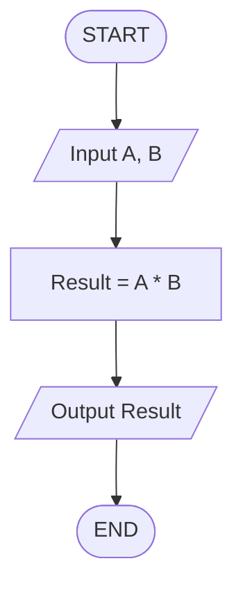
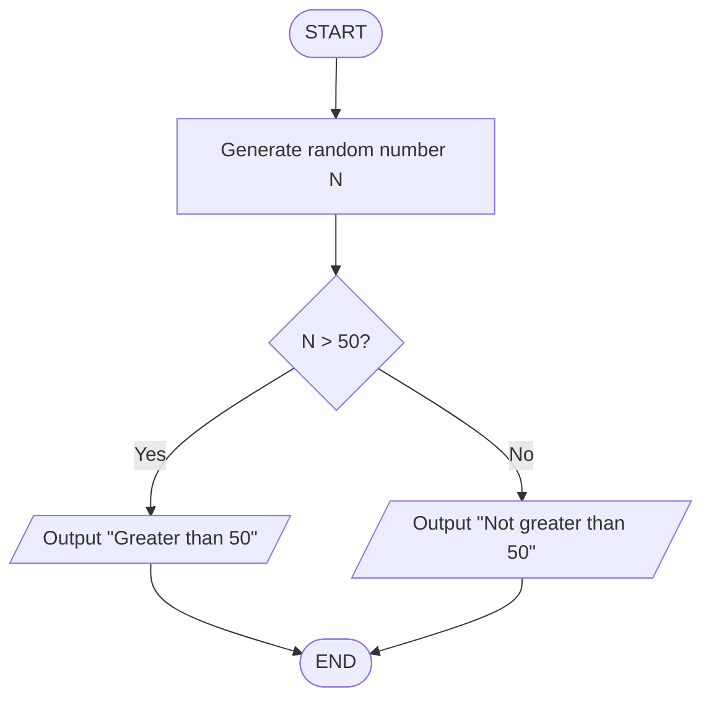
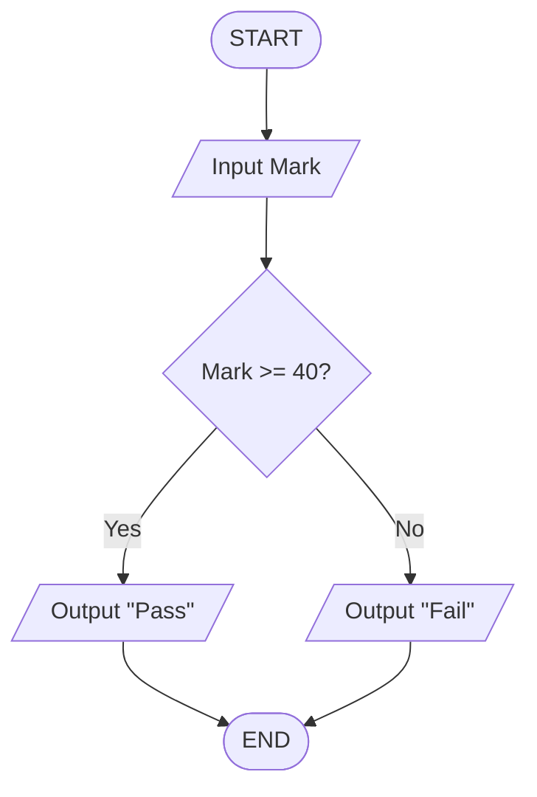
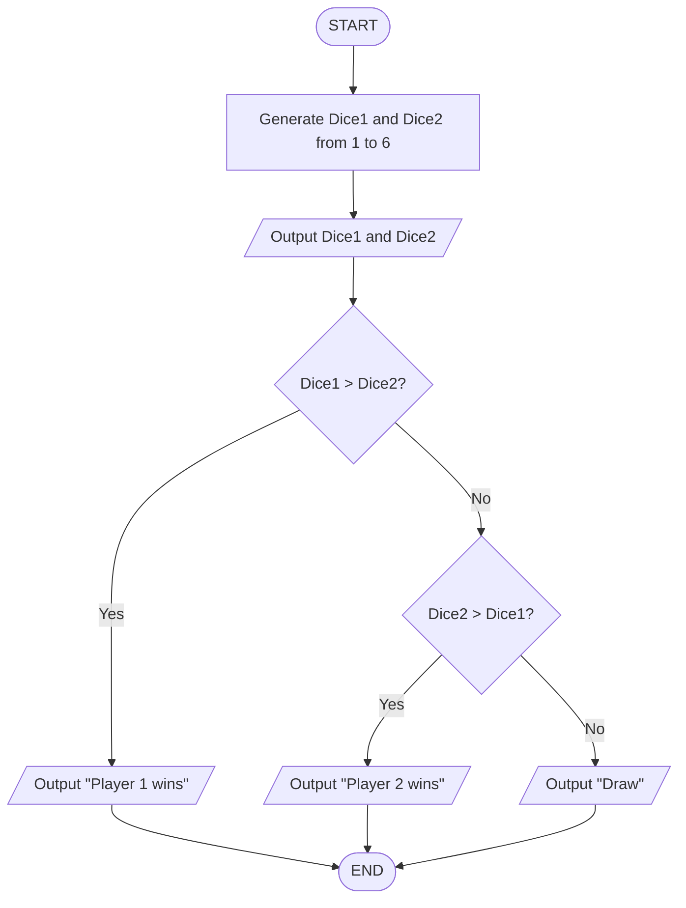
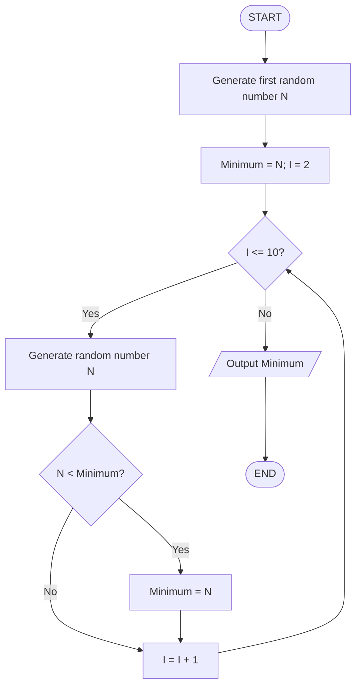
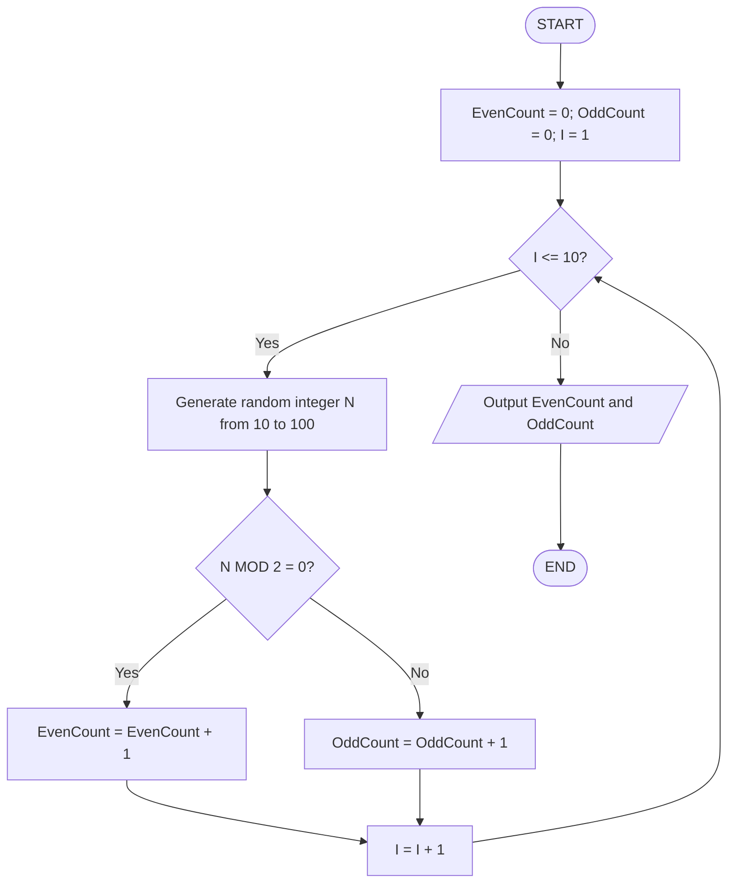
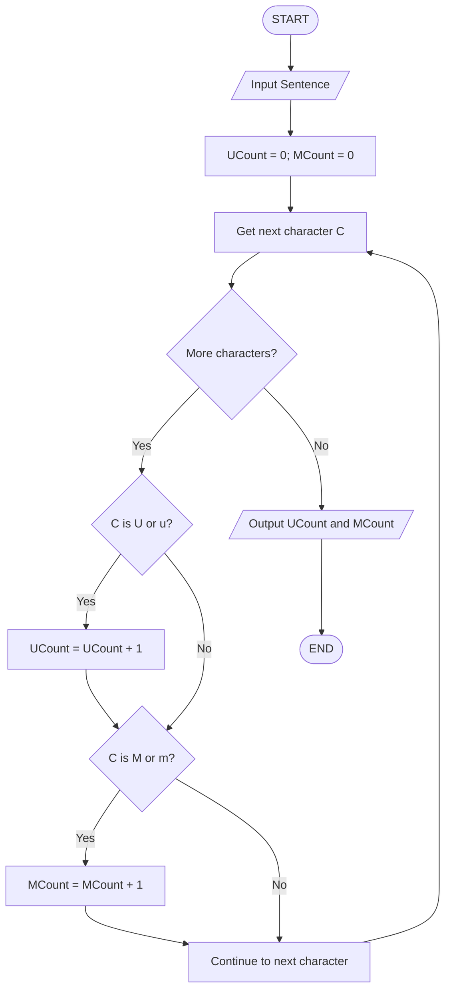
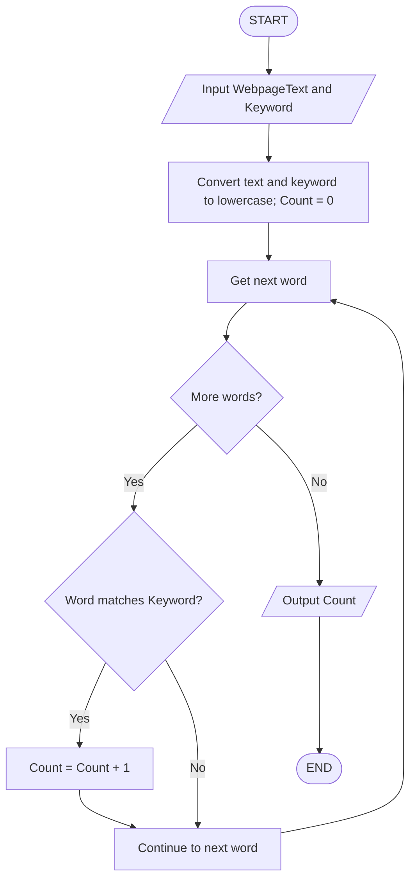
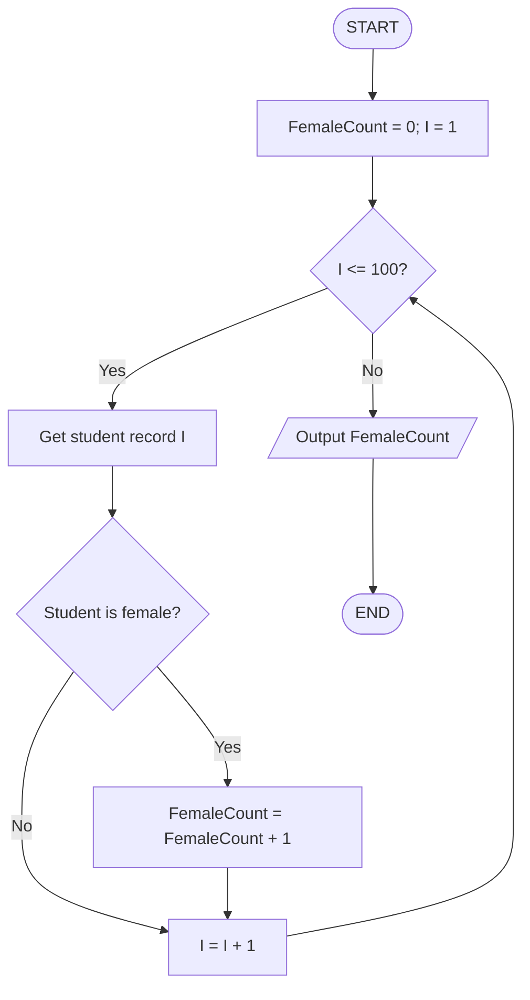
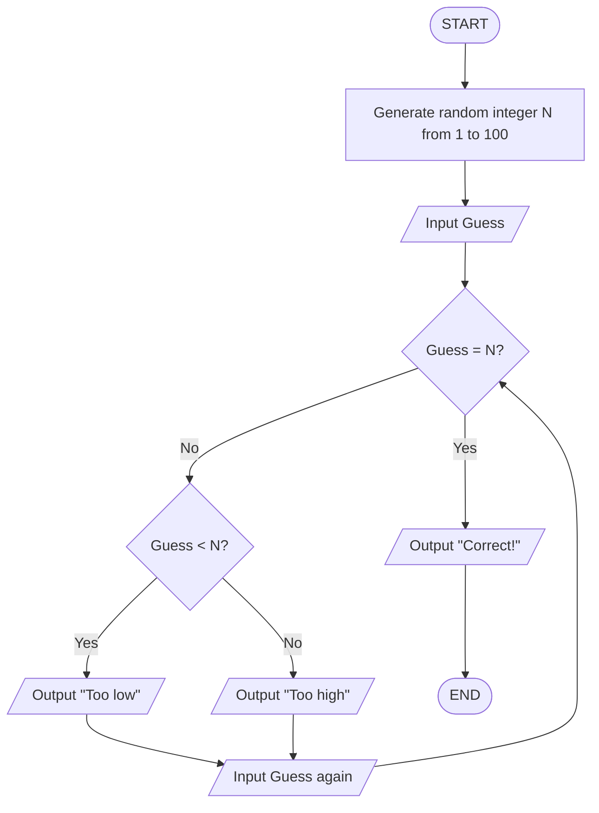

# Tutorial 01 Answers

## Part I

### Question 1: Multiply Two Numbers

#### IPO

| Input | Process | Output |
|---|---|---|
| Two numbers, `A` and `B`, entered by the user | Calculate `Result = A * B` | The product of `A` and `B` |

#### Pseudocode

```text
BEGIN
    INPUT A, B
    Result = A * B
    OUTPUT Result
END
```

#### Flowchart



### Question 2: Determine Whether a Random Number Is Greater Than 50

#### IPO

| Input | Process | Output |
|---|---|---|
| A random number, `N`, generated by the computer | Check whether `N > 50` | “Greater than 50” or “Not greater than 50” |

#### Pseudocode

```text
BEGIN
    Generate random number N
    IF N > 50 THEN
        OUTPUT "Greater than 50"
    ELSE
        OUTPUT "Not greater than 50"
    ENDIF
END
```

#### Flowchart



### Question 3: Print Pass/Fail Grade

#### IPO

| Input | Process | Output |
|---|---|---|
| The user's mark, `Mark` | If `Mark >= 40`, classify as pass; otherwise classify as fail | “Pass” or “Fail” |

#### Pseudocode

```text
BEGIN
    INPUT Mark
    IF Mark >= 40 THEN
        OUTPUT "Pass"
    ELSE
        OUTPUT "Fail"
    ENDIF
END
```

#### Flowchart



### Question 4: Print the Results of the Two Players’ Dice Game

I assume each player rolls one six-sided die. The higher number wins; equal numbers result in a draw.

#### IPO

| Input | Process | Output |
|---|---|---|
| The two dice values, `Dice1` and `Dice2`, generated by the computer | Compare the two values | Both dice values and the winner, or “Draw” |

#### Pseudocode

```text
BEGIN
    Generate random Dice1 from 1 to 6
    Generate random Dice2 from 1 to 6
    OUTPUT Dice1, Dice2

    IF Dice1 > Dice2 THEN
        OUTPUT "Player 1 wins"
    ELSE IF Dice2 > Dice1 THEN
        OUTPUT "Player 2 wins"
    ELSE
        OUTPUT "Draw"
    ENDIF
END
```

#### Flowchart



### Question 5: Print the Perimeter of a Rectangle

#### IPO

| Input | Process | Output |
|---|---|---|
| Rectangle length, `Length`, and width, `Width` | Calculate `Perimeter = 2 * (Length + Width)` | The perimeter |

#### Pseudocode

```text
BEGIN
    INPUT Length, Width
    Perimeter = 2 * (Length + Width)
    OUTPUT Perimeter
END
```

#### Flowchart

```mermaid
flowchart TD
    A([START]) --> B[/Input Length and Width/]
    B --> C[Perimeter = 2 * (Length + Width)]
    C --> D[/Output Perimeter/]
    D --> E([END])
```

### Question 6: Print the Minimum of 10 Random Numbers

#### IPO

| Input | Process | Output |
|---|---|---|
| Ten random numbers generated by the computer | Keep track of the smallest number seen so far | The minimum number |

#### Pseudocode

```text
BEGIN
    Generate random number N
    Minimum = N

    FOR I = 2 TO 10
        Generate random number N
        IF N < Minimum THEN
            Minimum = N
        ENDIF
    ENDFOR

    OUTPUT Minimum
END
```

#### Flowchart



### Question 7: Count Odd and Even Numbers Among 10 Random Numbers

#### IPO

| Input | Process | Output |
|---|---|---|
| Ten random integers from 10 to 100 | Check each number using `N MOD 2`; count even and odd values separately | The number of even values and the number of odd values |

#### Pseudocode

```text
BEGIN
    EvenCount = 0
    OddCount = 0

    FOR I = 1 TO 10
        Generate random integer N from 10 to 100
        IF N MOD 2 = 0 THEN
            EvenCount = EvenCount + 1
        ELSE
            OddCount = OddCount + 1
        ENDIF
    ENDFOR

    OUTPUT EvenCount, OddCount
END
```

#### Flowchart



## Part II

### Question 8: Count the Letters U and M in a Sentence

I counted both capital and small letters.

#### IPO

| Input | Process | Output |
|---|---|---|
| A sentence entered by the user | Examine each character and increase the appropriate counter when it is U/u or M/m | The count of U/u and the count of M/m |

#### Pseudocode

```text
BEGIN
    INPUT Sentence
    UCount = 0
    MCount = 0

    FOR each character C in Sentence
        IF C = "U" OR C = "u" THEN
            UCount = UCount + 1
        ENDIF
        IF C = "M" OR C = "m" THEN
            MCount = MCount + 1
        ENDIF
    ENDFOR

    OUTPUT UCount, MCount
END
```

#### Flowchart



### Question 9: Display the Frequency of a Keyword from a Web Page

I assume the webpage text is available to the algorithm. Frequency means the number of whole-word matches, ignoring letter case.

#### IPO

| Input | Process | Output |
|---|---|---|
| Webpage text and the keyword | Examine the words in the webpage text and count matches to the keyword | The keyword's frequency |

#### Pseudocode

```text
BEGIN
    INPUT WebpageText
    INPUT Keyword
    Count = 0

    Convert Keyword and WebpageText to lowercase
    FOR each word in WebpageText
        IF word matches Keyword THEN
            Count = Count + 1
        ENDIF
    ENDFOR

    OUTPUT Count
END
```

#### Flowchart



### Question 10: Display the Number of Female Students in a Random List of 100 Students

I assume each student record contains a gender value, and the list contains 100 student records.

#### IPO

| Input | Process | Output |
|---|---|---|
| A list of 100 student records, each with a gender value | Examine each student and increase the counter when the gender is female | The number of female students |

#### Pseudocode

```text
BEGIN
    FemaleCount = 0

    FOR I = 1 TO 100
        Get student record I
        IF StudentGender = "Female" THEN
            FemaleCount = FemaleCount + 1
        ENDIF
    ENDFOR

    OUTPUT FemaleCount
END
```

#### Flowchart



### Question 11: Display Five Random Numbers in Descending Order

I used bubble sort to arrange the numbers from big to small.

#### IPO

| Input | Process | Output |
|---|---|---|
| Five random numbers generated by the computer | Compare two numbers and swap if needed until all are sorted | The five numbers in descending order |

#### Pseudocode

```text
BEGIN
    Generate 5 random numbers and store them in A[1..5]

    FOR Pass = 1 TO 4
        FOR I = 1 TO 5 - Pass
            IF A[I] < A[I + 1] THEN
                Temp = A[I]
                A[I] = A[I + 1]
                A[I + 1] = Temp
            ENDIF
        ENDFOR
    ENDFOR

    OUTPUT A[1], A[2], A[3], A[4], A[5]
END
```

#### Flowchart

```mermaid
flowchart TD
    A([START]) --> B[Generate 5 random numbers in A]
    B --> C[Pass = 1]
    C --> D{Pass <= 4?}
    D -->|Yes| E[I = 1]
    E --> F{I <= 5 - Pass?}
    F -->|Yes| G{A[I] < A[I + 1]?}
    G -->|Yes| H[Swap A[I] and A[I + 1]]
    G -->|No| I[I = I + 1]
    H --> I
    I --> F
    F -->|No| J[Pass = Pass + 1]
    J --> D
    D -->|No| K[/Output numbers in A/]
    K --> L([END])
```

### Question 12: Guess a Random Number Generated by the Computer

I assume the computer generates an integer from 1 to 100, inclusive. The user keeps guessing until the correct number is entered.

#### IPO

| Input | Process | Output |
|---|---|---|
| The user's guesses; a random target number generated by the computer | Compare each guess with the target and give a hint | “Too low”, “Too high”, or “Correct!” |

#### Pseudocode

```text
BEGIN
    Generate random integer N from 1 to 100
    INPUT Guess

    WHILE Guess != N
        IF Guess < N THEN
            OUTPUT "Too low"
        ELSE
            OUTPUT "Too high"
        ENDIF
        INPUT Guess
    ENDWHILE

    OUTPUT "Correct!"
END
```

#### Flowchart


